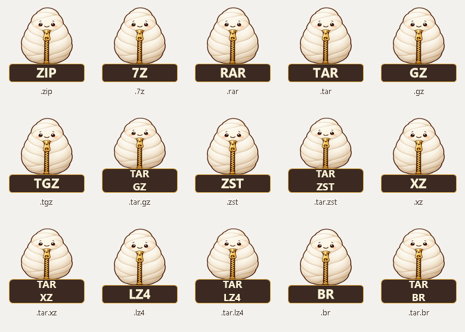

# 압축 파일 형식 아이콘

앱 아이콘은 누에나방, 압축 파일 아이콘은 지퍼 달린 누에고치 아래에 압축 형식 라벨을 붙인 모양이다.



지원 형식 15개와 일반 아카이브 아이콘 1개를 실행 파일에 내장한다. 각 ICO는 16/20/24/32/40/48/64/96/128/256px 이미지를 포함한다. 작은 크기에서는 픽셀 문자로 라벨을 표시하고, 큰 복합 형식 아이콘은 TAR와 코덱을 두 줄로 표시한다.

## 탐색기에 표시하기

1. Windows **설정 → 앱 → 기본 앱**을 연다.
2. **Mothzip**을 찾는다.
3. 사용할 압축 확장자의 기본 앱을 Mothzip으로 선택한다.

파일 연결에 `Bandizip.zip` 같은 이름이 남아 있어도 프로그램이 설치돼 있다는 뜻은 아니다. 현재 PC에서는 반디집 실행 파일과 설치 등록 항목이 없음을 확인했다. 이 설정은 보호된 UserChoice를 직접 고치거나 다른 프로그램의 ProgID를 덮어쓰지 않고, 정상 Windows UI에서 바꾼다.

복합 파일 이름은 Windows가 마지막 확장자의 연결을 사용할 수 있다. 예를 들어 `.tar.zst`는 ZST 아이콘으로 보일 수 있다. 이를 파일마다 동적으로 구분하는 별도 셸 확장은 추가하지 않았다.

## 재생성 및 구현

```powershell
.\tools\generate-file-icons.ps1
```

- 형식·리소스 기준: `src/core/file_types.rs`.
- 앱 원본: `assets/moth_icon.png`, 압축 파일 원본: `assets/cocoon_icon.png`.
- 원본은 내장 이미지 생성 도구로 제작했다. 프롬프트 요약: 따뜻한 크림색·갈색 외곽선·금색 지퍼의 귀여운 누에나방과 누에고치, 투명 배경, 작은 아이콘에서도 구분되는 실루엣.
- ICO·PNG·SVG 및 미리보기: `assets/file-icons/`.
- `build.rs`가 리소스를 내장한다. 파일 형식별 ProgID와 DefaultIcon은 공통 registry profile에서 만든다.
- 아이콘 리소스 번호를 음수로 지정해 그룹의 위치가 아니라 ID로 참조한다. 이전 공통 ProgID에는 일반 ARC 아이콘을 유지한다.
- OpenWithProgids는 다른 앱과 공유하므로 등록/제거 시 Mothzip 값만 관리한다. 등록이 끝나면 Explorer의 연결 캐시를 갱신한다.

Windows 파일 형식 연결은 [Microsoft의 ProgID 문서](https://learn.microsoft.com/en-us/windows/win32/shell/fa-progids)를 따른다.

## 누에나방·누에고치 아이콘 검증

- **[measured]** 회귀 검사 103사례·161회 호출 PASS.
- **[measured]** 앱을 포함한 17개 아이콘 그룹·170개 이미지가 ICO 원본과 일치. Windows API로 16/32/256px 아이콘을 51회 추출해 확인.
- **[measured]** 1.2.5 설치본의 해시가 아래 빌드 해시와 일치하며, 형식별 아이콘 15개 등록을 확인했다. 설치본에서도 51회 아이콘 추출을 통과했다.
- **사용자 확인 (2026-10-27)** 아이콘 연결을 완료했다. 종료 시 레지스트리 읽기에서도 ZIP의 `MothZip.Archive.zip` 연결을 확인했다. 다른 확장자의 실제 탐색기 표시는 사용자 확인을 기준으로 기록한다.
- 창 제목 표시줄도 실행 파일에 내장된 앱 아이콘을 사용한다.
- 공통 `MothZip.Archive`를 기본 앱으로 선택한 확장자는 ARC로 표시된다. 형식별 라벨은 기본 앱에서 `MothZip.Archive.zip` 등 형식별 연결을 선택해야 한다.

설치 및 패키지 바이너리 SHA-256:
`a152e5d1a63190020973786dba64e47850e3e4b6a7de4eb9d1e25a91767208c8`

증거:

- 최종 패키지: `target/release-packages/mothzip-1.2.5-final/`.
- `validation/build-icons.json`, `validation/installed-icons.json` — 빌드 및 설치본의 앱·파일 리소스 검증.
- `validation/release-validation.json` — 회귀 결과.
- `validation/install.json`, `validation/associations.json` — 설치 및 형식별 등록 결과.

검증 JSON은 최종 패키지의 `validation/`에 보존했다. 이전 빌드, 테스트 입력·출력, 내려받은 감사 도구와 작업 메모는 종료 정리 대상으로 분리했다. 재사용하는 검사 코드와 아이콘 재생성 도구는 저장소에 유지한다.
